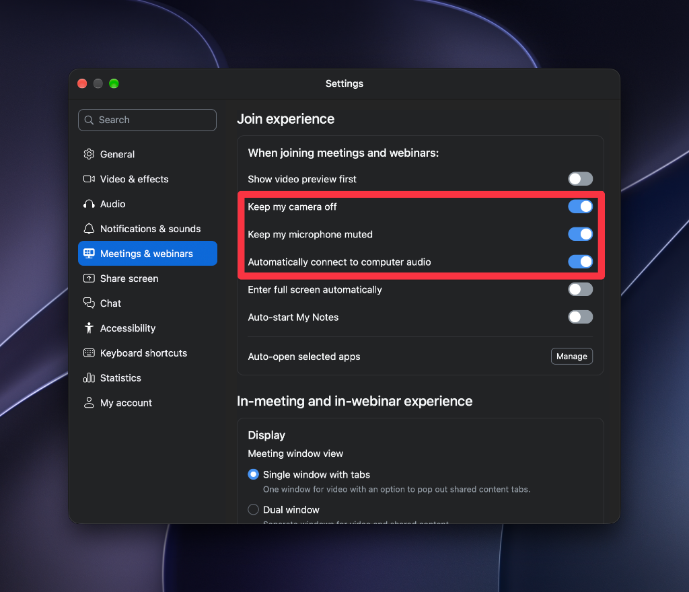

# YILDIZ Ders Otomasyonu

Yıldız Teknik Üniversitesi online derslerine (LMS) otomatik katılım sağlayan hafif, hızlı ve güvenli masaüstü otomasyonu.

Tarayıcı (Selenium) gerektirmez; doğrudan üniversite API'si üzerinden çalışır, ders saatlerini otomatik algılar ve vakti geldiğinde Zoom'u başlatır.

---

## 🚀 Özellikler

- **Tarayıcısız & Hafif:** Selenium gerektirmez, doğrudan hafif HTTP API kullanır; arka planda sessizce ve minimum kaynakla çalışır.
- **Otomatik Ders Çekme:** "Derslerimi Getir" butonuyla haftalık ders programınızı ve saatlerinizi tek tıkla senkronize eder.
- **Zamanında Katılım:** Ders saati geldiğinde Zoom'u doğrudan ders oturumuna bağlar.
- **Canlı Durum Göstergesi:** Arka plandaki durumu ve sıradaki dersi arayüzde anlık gösterir.
- **Discord Bildirimleri (Opsiyonel):** Derse girildiğinde veya hoca linki açmadığında Discord üzerinden telefonunuza bildirim gönderir.
- **Güvenli:** Şifreniz asla 3. parti bir sunucuya gitmez, işletim sisteminizin kasasında (Keychain / Credential Manager) saklanır.

---

## ⚡ Kurulum ve Çalıştırma

### Gereksinimler
1. **Python 3.8+** ([python.org](https://www.python.org/downloads/))
   - *Windows kullanıcıları:* Kurulumun ilk ekranındaki **"Add python.exe to PATH"** kutucuğunu mutlaka işaretleyin.
2. **Zoom Desktop** ([zoom.us/download](https://zoom.us/download))

### Başlatma

- **Windows:** `run_windows.bat` dosyasına çift tıklayın.
- **macOS:** `run_macos.command` dosyasına çift tıklayın.

*(Gerekli tüm sanal ortam ve paket kurulumları ilk çalıştırmada otomatik olarak yapılır.)*

---

## ⚙️ Önemli: Zoom Otomatik Katılım Ayarları

Uygulama ders saatinde Zoom'u toplantı linkiyle doğrudan başlatır. Ancak siz bilgisayar başında değilken toplantıya **ek bir tıklama yapmadan ve mikrofon/kamera kazaları yaşamadan** tam otomatik bağlanabilmesi için Zoom ayarlarını aşağıdaki gibi yapılandırmanız gerekir:

**Zoom Desktop → Ayarlar (Settings) → Meetings & webinars (Toplantılar):**
- ✅ **Keep my camera off** (Derse girerken kameramı kapalı tut)
- ✅ **Keep my microphone muted** (Derse girerken mikrofonumu sessize al)
- ✅ **Automatically connect to computer audio** (Bilgisayar sesine otomatik bağlan — *tıklama beklemeden sese bağlar*)

---

## 📖 Kullanım Rehberi

1. **Giriş Bilgileri:**  
   Okul e-postanızı (`ogrenci@std.yildiz.edu.tr`) ve şifrenizi girip **"Bilgileri Kaydet"** butonuna basın.
2. **Dersleri Ekleme:**  
   **"Derslerimi Getir (API)"** butonuna tıklayın, gelen listeden derslerinizi seçip **"Seçilenleri Ekle"** deyin. Günler ve saatler otomatik eklenir.
3. **Otomasyon:**  
   Uygulamayı açık bırakmanız yeterlidir. Ders saatinde Zoom otomatik başlatılır. *(Önemli: Bilgisayarınızın uykuya geçmesini engelleyin, aksi halde ders saatinde kaçırılır.)*
4. **Anlık Katılım:**  
   Ders saati içindeyken istediğiniz zaman **"Şimdi Derse Gir"** butonuna basarak derse anında bağlanabilirsiniz.
5. **Discord Bildirimi (İsteğe Bağlı):**  
   **"Ayarlar (Webhook)"** sekmesinden Discord Webhook adresinizi ekleyerek ders durumlarını telefonunuza bildirim olarak alabilirsiniz.

---

## ❓ Sorun Giderme

| Sorun | Çözüm |
|---|---|
| **"Giriş başarısız"** | Kullanıcı adı veya şifrenizi kontrol edin. |
| **Mac'te izin hatası** | Terminal'de `chmod +x run_macos.command` komutunu çalıştırın. |
| **Windows'ta Microsoft Store açılıyor** | Python kurulu değil veya PATH'e eklenmemiş; kurarken "Add to PATH" işaretleyin. |
| **`No module named tkinter` (macOS)** | Homebrew kullanıyorsanız `brew install python-tk` çalıştırın. |
| **Zoom açılmıyor** | Bilgisayarınızda Zoom Desktop uygulamasının kurulu olduğunu doğrulayın. |
| **Bozuk sanal ortam (venv)** | macOS'ta `./run_macos.command --recreate-venv`, Windows'ta `run_windows.bat --recreate-venv` çalıştırın. |

---

## 📄 Lisans

Bu proje [MIT Lisansı](LICENSE) altında dağıtılmaktadır.
